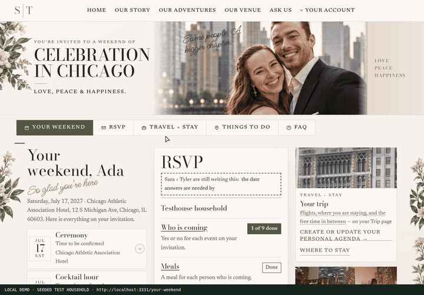
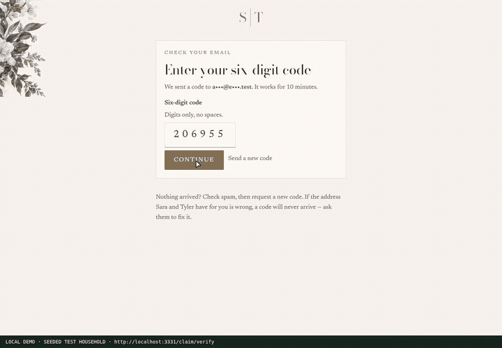

# Guest journey refinement — rendered comparisons and Webreel

The application changes make planning less form-heavy while retaining the approved wedding design and guest privacy boundary. These are captures of the running site, not mockups.

- **Before:** previous PR revision `f0362d1f8181b263b1259a93ad942b668298b00a`.
- **After:** application and regression coverage at `892dbef9e45345d27a55029ca2eafb4b9f88ea94`.
- **Still screenshots:** the same local seeded household and two demo activities, at 1440 × 1000 and 390 × 844. Test-only principal headers authenticate still captures.
- **Recording:** a real email-code session for `ada.testhouse@example.test`; no principal headers enter the recorded browser. Test-only Node requests prepare an active demo invitation, fixture meal and editing windows. These are not real guest records or the wedding menu.

## Actual feature recording

**[Complete 3:16 Webreel recording](guest-journey-webreel.mp4)** · [chapter timestamps](chapters.json) · [capture metadata](recording.json)

The full take is 1440 × 1000, 12 fps, approximately 11.3 MB, recorded with Webreel 0.1.4. The inline GIF is a 00:28–01:04 excerpt. Normal motion is enabled in the recording; reduced motion is tested separately.

The take asserts public gating, actual OTP sign-in, the compact weekend overview, conditional RSVP questions preserving an unsent meal, map pin/directions behavior, a generated plan, activity/flight/hotel field choices, an activity surviving reload and being confirmed, optional travel preferences, menu editing-window gating, a meal change through review/confirm, and sign-out hiding private tools again. All 14 chapter checkpoints completed.

## Focused composer recording

**[Complete 1:18 focused Webreel recording](composer-webreel.mp4)** · [chapters](composer-chapters.json) · [capture metadata](composer-recording.json)

This second real OTP session keeps the relevant controls in frame: activity → flight → hotel → activity, then optional details and travel preferences. Assertions require the revealed inputs to be inside the viewport, not merely present in the DOM. All eight checkpoints completed. The GIF is the 00:26–01:08 excerpt.

## Desktop comparisons

| Surface | Before | After |
|---|---|---|
| Weekend reply overview | [Before](before/weekend.jpg) | [After](after/weekend.jpg) |
| Personalized Chicago planning | [Before](before/planner.jpg) | [After](after/planner.jpg) |
| Personal agenda | [Before](before/agenda.jpg) | [After](after/agenda.jpg) |
| Add a plan | [Before](before/composer.jpg) | [After](after/composer.jpg) |
| RSVP attendance | [Before](before/rsvp.jpg) | [After](after/rsvp.jpg) |

## Phone comparisons

| Surface | Before | After |
|---|---|---|
| Weekend reply overview | [Before](before/weekend-mobile.jpg) | [After](after/weekend-mobile.jpg) |
| Personalized Chicago planning | [Before](before/planner-mobile.jpg) | [After](after/planner-mobile.jpg) |
| Personal agenda | [Before](before/agenda-mobile.jpg) | [After](after/agenda-mobile.jpg) |
| Add a plan | [Before](before/composer-mobile.jpg) | [After](after/composer-mobile.jpg) |
| RSVP attendance | [Before](before/rsvp-mobile.jpg) | [After](after/rsvp-mobile.jpg) |

[Before capture metadata](before/screenshots.json) · [After capture metadata](after/screenshots.json) · [self-review](../../reviews/PR-sara-feedback-self-review.md)
