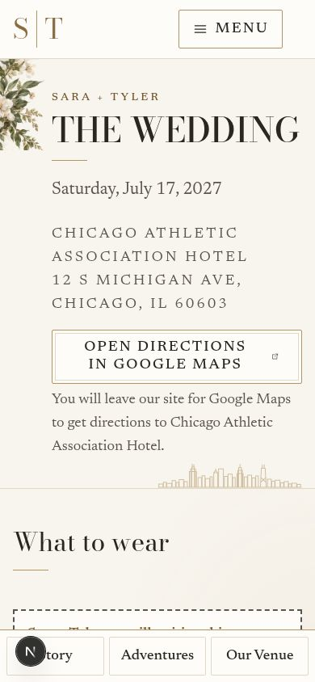
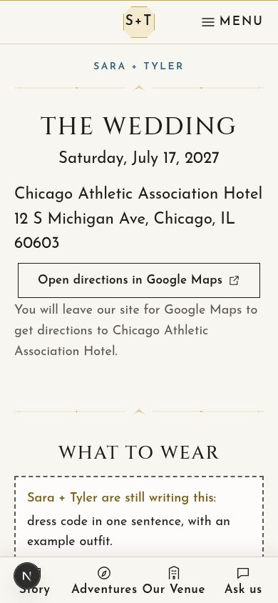
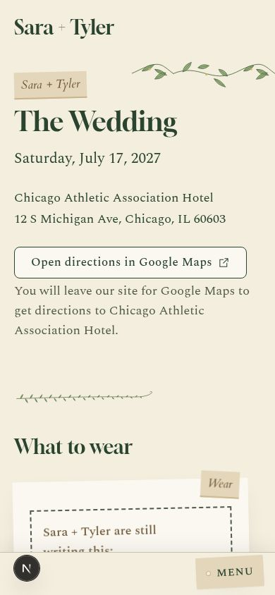
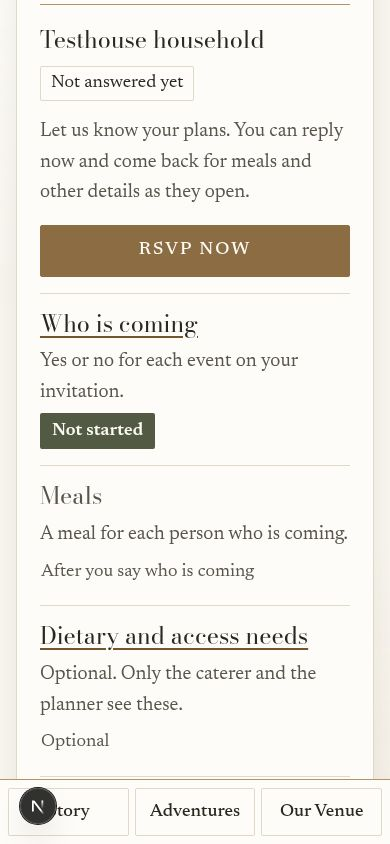

# Release review — October 29, 2026

Fresh local browser captures at 390 × 844, using the final working tree described by this commit. Measurements in [observations.json](observations.json) record section order, first-screen dress-code/directions bounds, reply action position and overflow. Screenshots show the actual page, including local development chrome; no compositing or generated mockups.

The baseline is the earlier PR capture at `b68ff15`: [wedding](../sara-feedback/after/wedding.jpg) and [weekend phone](../guest-journey-refinement/after/weekend-mobile.jpg). The wedding baseline is a desktop section capture; compare content order rather than pixel dimensions. The new phone images verify first-screen essentials in all three themes. The weekend fixture is unanswered/open with demo guests and does not imply actual wedding menu or RSVP availability.

| Wedding theme | Phone screenshot |
|---|---|
| Botanical Deco |  |
| Gilded Hour |  |
| Conservatory |  |

[Existing real guest-journey Webreel recordings](../guest-journey-refinement/README.md) show actual email-code sign-in, map/planning, persisted agenda changes, meal review/confirm, and sign-out gating.
